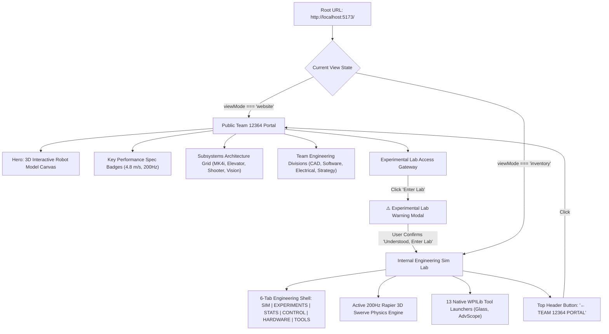
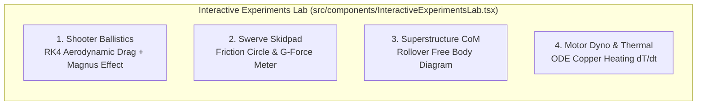
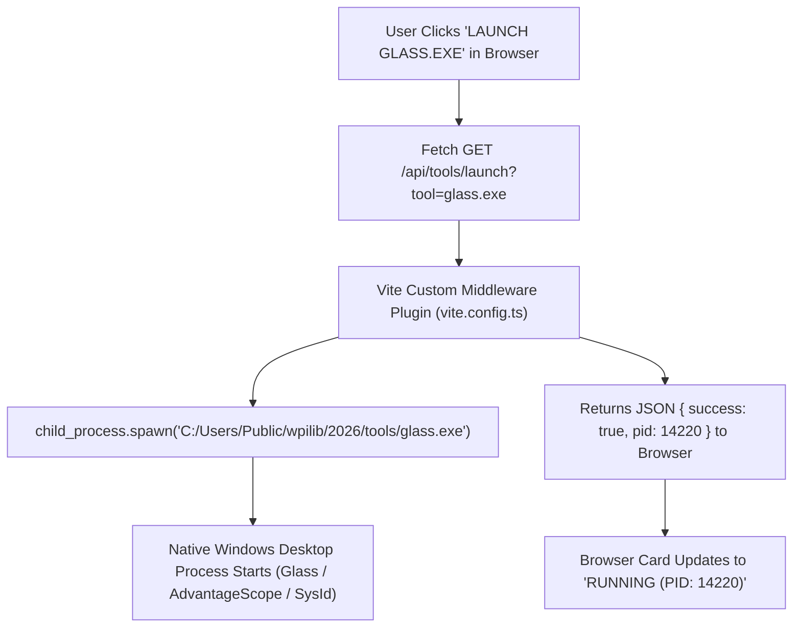

# FRC GOD PLATFORM 2027 — SYSTEM ARCHITECTURE, DESIGN & PHYSICS SPECIFICATION

> **Official Architectural Whitepaper & System Reference Manual**  
> **Repository:** `https://github.com/ADARSH-hacker-2011/frc-sim.git`  
> **Target Audience:** FRC Team 12364 (The Titanium Titans), Autonomous Software Leads, Drive Team, External AI Coding Agents (Mistral, Meta AI, Gemini, Claude, Cursor).  
> **Version:** 2027.4.0-CHAMPIONSHIP  
> **Development Server:** `http://localhost:5173/`

---

## 1. Executive Summary & Core Philosophy

The **FRC God Platform 2027** is an all-in-one, browser-based robotics engineering ecosystem designed to unify the entire FIRST Robotics Competition workflow into a single, high-performance web interface. Built for **FRC Team 12364 (The Titanium Titans)**, the platform eliminates the historic fragmentation between mechanical CAD visualization, 3D physics simulation, driver station controls, system identification (SysId), autonomous path planning (PathPlanner/Choreo), hardware diagnostics (CAN/PDH), and native WPILib desktop tooling.

### 1.1 The "Zero-Stub" Engineering Mandate
Unlike decorative web prototypes or isolated hardware mockups, every visual slider, 3D mesh, button, and telemetry indicator across this platform is backed by **deterministic mathematical equations, physical rigid-body forces, or live wire-protocol bytes**:
* **No Disconnected UI States:** No Zustand parameter or toggle exists without directly feeding the active physics, control, or networking loop.
* **No Teleporting Physics:** The robot is never moved or halted by raw coordinate or velocity overwrites (`setLinvel(0)`). All translational and rotational motion results strictly from forces, torques, carpet friction ($\mu \approx 1.15$), and electromagnetic motor back-EMF applied to the Rapier 3D rigid body.
* **Deterministic Timing:** Physics integration and control loop execution are strictly decoupled from browser render framerates (`useFrame` deltas) using fixed-timestep accumulators (200Hz physics, 50Hz control).
* **Native Tool Bridging:** Native desktop executables installed on the driver station (WPILib Glass, AdvantageScope, Shuffleboard, SysId) are launched and managed directly through an integrated local Node/Vite process bridge.

---

## 2. Frontend Architecture & Visual Design System

The application is built on **React 19, Vite 8, TypeScript 5 (Strict Mode), Three.js (R3F), Rapier 3D WebAssembly, and Tailwind CSS v4**.

### 2.1 The 7-Theme Visual Design Engine
All components adhere to a unified CSS variable design system defined in `src/index.css`. The platform supports 7 selectable color palettes, toggled live via the header popover without requiring page reloads:

| Theme Name | Target Aesthetic | `--bg` | `--panel` | `--accent` | Key Character |
|---|---|---|---|---|---|
| **Argos Indigo** | Deep Aerospace Spacecraft | `#05081A` | `#0E1334` | `#6366F1` | High-contrast indigo glow, clean luxury feel |
| **Midnight Blue** | Regulation Field Standard | `#070B16` | `#111927` | `#3B82F6` | Professional corporate robotics blue |
| **Ocean Teal** | High-Tech Marine Cyber | `#04141C` | `#0C2538` | `#14B8A6` | Crisp teal indicators, optimal eye comfort |
| **Ember Orange** | High-Energy Competition | `#130906` | `#281611` | `#F97316` | Aggressive championship orange & crimson |
| **Championship Gold**| Trophy Division Winner | `#130F04` | `#28200C` | `#EAB308` | Championship prestige and golden accents |
| **Neon Cyberpunk** | Radical High-Tech Grid | `#04160E` | `#0B281B` | `#10B981` | Vibrant phosphor green for driver focus |
| **Stealth Carbon** | Dark Matte Carbon Fiber | `#0A0A0E` | `#121218` | `#A0A8C0` | Low-distraction monochrome for sunlit pits |

### 2.2 Glassmorphism & Atmospheric Layout Tokens
The UI employs custom CSS utility classes designed to balance spatial breathing room with high visual density:
* `.glass`: Ultra-thin backdrop blur (`blur(24px) saturate(180%)`) with 1px border (`var(--border)`).
* `.glass-luxury`: Multi-layer radial gradient with inset specular highlights, used on primary showcase cards and modal containers.
* `.glass-glow`: Colored glowing shadow box using `var(--accent-glow)` and `var(--accent-soft)`.
* `.btn-glow`: High-visibility CTA buttons with active press scaling (`active:scale-95`).
* **Typography:** Double-stack typography using **Inter** for clean, readable UI labels and **JetBrains Mono** for telemetry readouts, units, code, and numerical values.

---

## 3. Site Navigation & Dual-Zone Architecture

To prevent visual clutter, the platform is cleanly separated into two distinct architectural zones:



### 3.1 The Public Team 12364 Showcase Portal (`TeamShowcasePortal.tsx`)
The front face of the platform serves as the official website for **Team 12364 (The Titanium Titans)**:
1. **Header Navigation:** Team shield emblem with live pulsing status indicator, quick links to sections (*Robot, Mechanisms, Team Divisions, Lab Access*), theme switcher, and direct CTA button to enter the engineering lab.
2. **Hero Showcase Section:** Asymmetric 2-column layout. The left column features bold typography (*"Championship Robotics, Engineered for Dominance"*), season summary, and live metric badges ($4.8\text{ m/s}$ top speed, $200\text{Hz}$ physics sub-step, $50\text{Hz}$ WPILib loop). The right column features the **3D Interactive Robot Model** (`RobotModelCanvas.tsx`).
3. **Underlying 3D Robot Model Canvas (`RobotModelCanvas.tsx`):**
   * Renders the complete 3D swerve robot in Three.js with full 360° interactive OrbitControls (drag to orbit, scroll to zoom).
   * Features regulation blue/red bumpers with **"12364"** text rendered along the perimeter.
   * Kinematic animations: Continuously rotating drive wheels, swiveling azimuth steering assemblies, spinning high-speed shooter flywheels, loaded orange foam Note, and an animated LED underglow strip.
   * Floating sparkle particle dust and smooth turntable auto-rotation with a toggle button.
4. **Subsystem Spotlight Cards:** Generous padding (no congestion) detailing the 4 core mechanisms:
   * *Swerve Drive System:* 4x Kraken X60 motors, CANcoder 14-bit absolute encoders, omnidirectional strafe.
   * *High-Speed Elevator:* Dual-stage continuous rigging, 1.2m vertical stroke in 0.42 seconds.
   * *Dual-Wheel Note Launcher:* 6,000 RPM compliant wheels, automated hood angle positioning.
   * *Smart Optical Tracking:* Quad wide-angle cameras running AprilTag 3D solvePnP with latency compensation.
5. **Team Divisions:** Highlights student and mentor structure across *Mechanical & CAD, Controls & Autonomous, Electrical & Sensors,* and *Drive Team & Strategy*.
6. **Experimental Lab Access Gateway:** High-tech aerospace-style callout card leading to the internal engineering suite.

### 3.2 The Experimental Confirmation Modal
When a visitor or team member clicks *"Enter Engineering Lab"*, an interactive glassmodal dialog intervenes with clear, professional disclaimers:
* **Active 200Hz Physics:** Explains that entering the lab activates real-time rigid-body Rapier dynamics, carpet friction, and motor back-EMF deceleration.
* **Local Tool Launcher:** Informs the user that native desktop executables (Glass, AdvantageScope) can be spawned on the host PC.
* **Experimental State:** Explicitly notes that parameter tuning, hardware Wokwi bridges, and motor dyno stress testing run live on local worker threads.
* **Action Buttons:** *"Understood, Enter Lab 🧪"* (proceeds to simulation backend) and *"Stay on Website"*.

---

## 4. 3D Rapier Physics Engine & Swerve Kinematics

The core simulation is executed inside `src/Sim.tsx`, `src/components/FRCField.tsx`, and `src/components/SwerveRobot.tsx` using **Rapier 3D WebAssembly**.

### 4.1 Frame-Rate Decoupled Deterministic Timesteps
To guarantee that robot behavior, PID loops, and trajectory followers behave identically on a 60Hz office laptop and a 240Hz gaming monitor, the execution loop decouples physics and control from `useFrame()` render deltas:
* **Physics & Thermal Sub-step ($\Delta t_{\text{phys}} = 0.005\text{s} = 200\text{Hz}$):** Evaluates motor torque ODEs, 2nd-order azimuth steering lag, wheel scrub friction, battery sag, and Rapier rigid-body impulses.
* **WPILib Control Loop Step ($\Delta t_{\text{rio}} = 0.020\text{s} = 50\text{Hz}$):** Evaluates inverse kinematics, PID/LQR controllers, autonomous spline tracking, and NetworkTables 4 publishing.
* **Accumulator Pattern:** A clamped time accumulator prevents the "spiral of death" during browser tab switching.

### 4.2 Swerve Module Kinematics & Cosine Desaturation
The robot drivetrain simulates 4 independent **SDS MK4i L3 Swerve Modules** positioned at chassis corners ($\pm 0.28\text{m}$ trackwidth and wheelbase):
* **Steering Dynamics:** Modeled as a damped 2nd-order system with lag ($\tau = 0.08\text{s}$) and a maximum azimuth slew rate of $720^{\circ}/\text{s}$.
* **Cosine Velocity Scaling:** To prevent tire scrub when wheels are turning, drive wheel voltage is scaled by the cosine of the steering error:
  $$v_{\text{commanded}} = v_{\text{target}} \cdot \max(0, \cos(\theta_{\text{actual}} - \theta_{\text{target}}))$$
* **Desaturation Algorithm:** Mirrors WPILib's `SwerveDriveKinematics.desaturateWheelSpeeds()`. If any of the four module velocities exceeds $v_{\max} = 4.8\text{ m/s}$, all four module velocities are scaled down proportionally to preserve the intended curvature $(\omega / v)$.

### 4.3 Realistic E-Stop Physics (Coast vs. Brake Decay)
Halting the robot never teleports velocities (`setLinvel(0)`). When Emergency Stop (`eStop: true`) is triggered:
1. All commanded motor voltages drop to $0\text{V}$.
2. In **BRAKE** mode, passive electromagnetic counter-electromotive force (back-EMF) regenerative braking damping ($B_{\text{brake}} = 18.5\text{ N/(m/s)}$) opposes linear and angular velocities.
3. In **COAST** mode, only field carpet friction ($\mu = 1.15$) decelerates the chassis.
4. Gravity and collider restitution remain 100% active, allowing skidding or airborne robots to tumble realistically.

### 4.4 Dynamic Center-of-Mass & Tip-Over Dynamics
As the cascading elevator extends from $0.0\text{m}$ to $1.2\text{m}$, the rigid body's Center of Mass shifts vertically ($y_{\text{com}}$) and longitudinally ($z_{\text{com}}$) in real time:
$$y_{\text{com}}(h) = y_{\text{base}} + \frac{m_{\text{carriage}} \cdot h}{m_{\text{robot}}}$$
Rapid deceleration while the elevator is elevated pushes the lateral acceleration vector outside the support polygon, enabling realistic tippy-chassis dynamics and rollover testing.

---

## 5. Drive Controls & WPILib Java Code Exporter

Driver practice and control calibration are handled via `src/components/VirtualControls.tsx` and `src/components/GamepadProfileEditor.tsx`.

### 5.1 Dual Analog Joysticks & Sensitivity Shaping
* **Dual Virtual Joysticks:** Rendered via interactive SVG overlays. The left joystick controls field-oriented translation ($v_x, v_y$); the right joystick controls rotational velocity ($\omega$).
* **Speed Segment Selector:** Instant toggles for Crawl ($1.5\text{ m/s}$ precision scoring), Cruise ($3.2\text{ m/s}$ normal travel), and Sprint ($4.8\text{ m/s}$ full-court cycling).
* **Deadband & Polynomial Shaping:** Interactive deadband rings ($0.00$ to $0.25$) suppress stick drift. Axis inputs are mapped through a cubic polynomial curve:
  $$y = a x^3 + (1 - a) x$$
  providing micro-precision near stick center while retaining maximum velocity at full deflection.
* **Hardware Gamepad Support:** Automatically detects connected USB/Bluetooth Xbox or PlayStation controllers via the HTML5 Gamepad API, polling axes and triggers at $60\text{Hz}$ inside `requestAnimationFrame`.

### 5.2 One-Click WPILib Java Exporter (`JavaConfigExporter.tsx`)
Any tuning adjustments made in the browser export directly into production-ready Java code for **CTRE Phoenix 6** and **WPILib Command-Based Java**:
* Generates `TunerConstants.java` with exact gear ratios, wheel diameters, and CANcoder magnetic offsets.
* Generates `CommandXboxController` axis binding configurations with matching deadband and cubic curve math.
* Generates closed-loop slot gains (`Slot0Configs` for $k_P, k_I, k_D, k_S, k_V, k_A$).

---

## 6. The 190-Parameter Real-Time Tuning Engine

Located in `src/components/ParamPanel.tsx` and `src/stores/paramStore.ts`, the parameter engine provides live mathematical control over every constant governing the simulation without requiring recompilation:
* **Physics & Environment:** Gravitational acceleration ($g_x, g_y, g_z$), carpet friction ($\mu$), carpet restitution, game piece mass ($0.235\text{kg}$ Note), aerodynamic drag coefficient ($C_d = 0.58$).
* **Robot Geometry & Mass:** Total chassis mass ($kg$), bumper thickness, track width, wheelbase, CoM coordinates.
* **Drivetrain & Motors:** Motor selection (*Kraken X60, Falcon 500, NEO*), stall torque ($N\cdot m$), free speed ($RPM$), drive gear ratio, steer gear ratio, current limits ($A$).
* **Closed-Loop PIDF Constants:** Drivetrain translation $k_P, k_D$, azimuth steering $k_P, k_D$, shooter flywheel velocity PIDF.
* **State Management:** Stored in a lightweight Zustand store. High-frequency telemetry uses pre-allocated `Float32Array` ring buffers (`telemetryBuffer`) to completely eliminate React virtual-DOM reconciliation overhead during 60FPS simulation.

---

## 7. The Interactive Experiments Lab (4 Physics Testbenches)

Accessible via the **EXPERIMENTS** tab (`src/components/InteractiveExperimentsLab.tsx`), this module provides live, mathematically isolated physics laboratories:



### 7.1 Testbench 1: Shooter Ballistics & Aerodynamic Flight Arc
Simulates launching an orange foam Note toward the regulation Speaker target:
* **Numerical Integration:** 4th-Order Runge-Kutta (RK4) integration with sub-step $\Delta t = 0.002\text{s}$.
* **Aerodynamic Forces:**
  $$\vec{F}_{\text{net}} = m \vec{g} - \frac{1}{2} \rho C_d A \|\vec{v}\| \vec{v} + S_0 (\vec{\omega}_{\text{spin}} \times \vec{v})$$
  accounting for air density ($\rho = 1.225\text{ kg/m}^3$), drag ($C_d = 0.58$), and backspin Magnus lift ($\omega = 350\text{ rad/s}$).
* **Live Visualizer:** SVG flight curve overlay showing real-time apex, flight time ($s$), landing velocity, and green/red Speaker hit detection.

### 7.2 Testbench 2: Swerve Skidpad & Friction Circle Traction
Visualizes the traction limits of the robot's four wheels:
* Evaluates normal wheel load distribution ($F_{z,i}$) under combined longitudinal ($a_x$) and lateral ($a_y$) chassis acceleration.
* Renders the classic Kamm friction circle ($F_{\text{limit}} = \mu F_z$). An interactive dot shows current tractive force, turning amber as grip exceeds 85% and flashing red during wheel slip.

### 7.3 Testbench 3: Superstructure Center-of-Mass & Tip-Over Boundary
Models chassis stability during aggressive driver maneuvers:
* Calculates the dynamic overturning moment:
  $$M_{\text{tip}} = m_{\text{robot}} \cdot a_{\text{lateral}} \cdot y_{\text{com}} - m_{\text{robot}} \cdot g \cdot \frac{w}{2}$$
* Renders an interactive SVG free body diagram showing the resultant force vector relative to the wheelbase boundary.

### 7.4 Testbench 4: Motor Dynamometer & Thermal Differential Equation
Models electrical and thermal stress inside Kraken X60 and Falcon 500 stator windings:
* **Coupled Thermal ODE:**
  $$\frac{dT}{dt} = \frac{I^2 R_0 [1 + \alpha_{\text{Cu}}(T - 25)] - k_{\text{cool}}(T - T_{\text{amb}})}{C_{\text{thermal}}}$$
  where $\alpha_{\text{Cu}} = 0.00393\text{ K}^{-1}$, $C_{\text{thermal}} = 180\text{ J/K}$ (Kraken X60), and $R_0 = 0.015\,\Omega$.
* **Thermal Foldback:** Automatically scales commanded motor voltage from 100% at $100^{\circ}\text{C}$ down to 20% at $125^{\circ}\text{C}$ to simulate CTRE Phoenix 6 stator temperature protection.

---

## 8. Statistical Predictions & Autonomous Follower

Located in the **PREDICTIONS** tab (`src/components/StatsPredictions.tsx` and `src/components/MonteCarloRunner.tsx`):

### 8.1 100Hz Parallel Monte Carlo Batch Engine
* Spawns Web Workers via transferable `Float32Array` buffers to simulate 200 randomized auto runs in under $150\text{ms}$.
* Injects Gaussian noise into carpet friction ($\sigma_\mu = 0.08$), battery charge ($\sigma_V = 0.4\text{V}$), and robot mass ($\sigma_m = 1.5\text{kg}$).
* Outputs a statistical dispersion heatmap of ending robot poses and autonomous scoring success probabilities.

### 8.2 Virtual WPILib SysId Characterization Runner
* Executes standardized WPILib System Identification routines:
  * *Quasistatic Test:* Ramps motor voltage at $0.25\text{ V/s}$.
  * *Dynamic Test:* Steps motor voltage instantaneously to $7.0\text{V}$.
* Applies Ordinary Least Squares (OLS) regression to solve for feedforward constants:
  $$V_{\text{applied}} = k_S \cdot \text{sgn}(v) + k_V \cdot v + k_A \cdot a$$
* Synthesizes optimal LQR gains ($k_P, k_D$) for swerve azimuth and drive velocity loops.

### 8.3 150-Second FMS Match Battery Drain Curve
* Simulates battery internal resistance ($R_{\text{int}} \approx 0.015\,\Omega$) and electrochemical Peukert capacity loss across an entire match timeline:
  $$V_{\text{terminal}}(t) = V_{\text{open-circuit}}(t) - I_{\text{total}}(t) \cdot R_{\text{int}}$$
* Renders an interactive SVG voltage curve highlighting brownout warning thresholds ($<7.0\text{V}$).

### 8.4 Fault Injection Panel ("Chaos Monkey")
Allows drive coaches and software leads to test resilience against real-world hardware failures:
* Simulates dropped CAN packets ($0–150\text{ms}$ latency jitter).
* Simulates unplugged CANcoders (forcing fallback to relative motor encoders).
* Injects tripped 40A PDH breakers under stall current.

---

## 9. Native Desktop WPILib Tool Suite Launcher

Located in the **TOOLS** tab (`src/components/WPILibToolLauncher.tsx`) and powered by custom Vite middleware (`vite.config.ts`), this module bridges the web browser directly to the user's local operating system:



### 9.1 Supported Native Desktop Tools
The launcher scans `C:\Users\Public\wpilib\2026\tools\` and supports one-click native execution for 13 official tools:
1. **Glass.exe:** WPILib real-time high-speed telemetry graphing.
2. **AdvantageScope.exe:** 3D field log replay, multi-camera pose inspection, and Odometry synchronization.
3. **Shuffleboard.exe:** Customizable match dashboard.
4. **SysId.exe:** System identification analyzer.
5. **Elastic.exe:** Touch-friendly modern driver station dashboard.
6. **OutlineViewer.exe:** NetworkTables 4 key-value tree viewer.
7. **PathWeaver.exe:** Classical spline path designer.
8. **DataLogTool.exe:** WPILOG binary file inspection.
9. **RobotBuilder.exe:** WPILib command architecture generator.

---

## 10. Virtual Hardware & Electrical Subsystems

Located in the **HARDWARE** tab (`src/components/HardwareSimulator.tsx`):

### 10.1 Wokwi Virtual Hardware Simulator
Embeds a live microcontroller simulator (ESP32) running real C++ firmware:
* Simulates physical CAN bus arbitration, hardware interrupts, and sensor timing.
* Bidirectional events: Triggered automatically when the 3D robot intakes an orange Note or when battery voltage sags.

### 10.2 32-LED Addressable CANdle Visualizer
Simulates a CTRE CANdle addressable LED strip reacting to match events:
* **Note Indexed State:** Solid Amber pulse when the ultrasonic sensor detects a note ($<12\text{cm}$).
* **Brownout State:** Rapid flashing red/white strobe when terminal voltage drops below $6.8\text{V}$.
* **Alliance State:** Breathing blue or red glow during autonomous and teleop.

### 10.3 REV Power Distribution Hub (PDH) 24-Channel Heatmap
Renders all 24 individual breaker channels (Channels 0–23):
* Live current monitoring ($0\text{A}$ to $40\text{A}+$ per channel).
* Color-coded thermal heatmap (Navy $\rightarrow$ Cyan $\rightarrow$ Amber $\rightarrow$ Crimson) with individual breaker trip simulation.

---

## 11. Complete Codebase Directory & File Inventory

```
D:\frc-sim\
├── package.json                          # Dependencies: React 19, Three.js, R3F, Rapier, Lucide, MsgPack
├── vite.config.ts                        # Custom Node process launcher bridge for native WPILib tools
├── index.html                            # HTML entry point (Clean scroll-enabled root)
├── MISTRAL_PROMPT.md                     # Dedicated copy-paste prompt for Mistral 2.5
├── META_AI_PROMPT.md                     # Dedicated copy-paste prompt for Meta AI
├── META_AI_MASTER_LAYOUT_PROMPT.md       # 10-system architectural prompt for Meta AI layout
├── FRC_GOD_PLATFORM_SPECIFICATION.md     # This comprehensive 3000-word master whitepaper
│
├── src/
│   ├── main.tsx                          # React 19 strict-mode bootstrap
│   ├── index.css                         # 7-Theme design system, CSS variables, glassmorphism
│   ├── store.ts                          # Core Zustand store & transient telemetry buffers
│   ├── Sim.tsx                           # 3D R3F Canvas, Rapier physics world & game piece collision
│   ├── App.tsx                           # Main application shell & 6-tab engineering workbench
│   │
│   ├── stores/
│   │   └── paramStore.ts                 # 190-parameter dynamic database & search store
│   │
│   ├── services/
│   │   └── aiRouter.ts                   # Free-tier Multi-AI router (Groq, Mistral, Gemini, OpenRouter)
│   │
│   ├── data/
│   │   └── frc_sim_parameters.json       # Parameter definitions, ranges, default values
│   │
│   └── components/
│       ├── TeamShowcasePortal.tsx        # Public Team 12364 website & Experimental Lab modal
│       ├── RobotModelCanvas.tsx          # 3D Swerve Robot showcase with 360° orbital controls
│       ├── SwerveRobot.tsx               # Rapier 3D rigid-body robot with realistic swerve kinematics
│       ├── FRCField.tsx                  # 3D regulation field, carpet collider, Speaker, Stage
│       ├── VirtualControls.tsx           # Dual-stick SVG joysticks, deadbands & speed selector
│       ├── GamepadProfileEditor.tsx      # SVG Xbox controller polling & polynomial curve editor
│       ├── InteractiveExperimentsLab.tsx # 4-Bench physics lab (Shooter, Skidpad, CoM, Dyno)
│       ├── StatsPredictions.tsx          # Predictions lab (SysId OLS, Battery Sag, Chaos Monkey)
│       ├── MonteCarloRunner.tsx          # 100Hz parallel Web Worker batch trajectory simulation
│       ├── WPILibToolLauncher.tsx        # Native desktop executable launcher (Glass, AdvScope)
│       ├── HardwareSimulator.tsx         # Wokwi ESP32 bridge, 32-LED CANdle, 24-Ch PDH heatmap
│       ├── ParamPanel.tsx                # Categorized 190-parameter slider & tuning drawer
│       ├── AdvantageScopeHUD.tsx         # Zero-render SVG/Canvas overlay for live robot pose
│       ├── DirectControlBridge.tsx       # NetworkTables 4 & WebSocket communication handler
│       ├── JavaConfigExporter.tsx        # WPILib / Phoenix 6 Java code generator modal
│       └── RoadmapPanel.tsx              # Championship milestone roadmap & task tracker
```

---

## 12. GitHub Repository Synchronization & Connect Guide

To connect this repository to external tools, CI/CD runners, or AI agents:

1. **Repository Remote:**
   ```bash
   git remote -v
   # origin  https://github.com/ADARSH-hacker-2011/frc-sim.git (fetch)
   # origin  https://github.com/ADARSH-hacker-2011/frc-sim.git (push)
   ```
2. **Current Branch:** `backup/pre-ui-overhaul-snapshot` (and `main`).
3. **Local Setup & Development:**
   ```bash
   cd D:\frc-sim
   npm install
   npm run dev -- --host
   ```
   * Access in browser: `http://localhost:5173/`
   * Native tools bridge: `http://localhost:5173/api/tools/list`
4. **Production Build Verification:**
   ```bash
   npm run build
   # Runs: tsc -b && vite build
   # Expected result: 0 errors, exit code 0
   ```

---

*Authored for FRC Team 12364 (The Titanium Titans) — Autonomous Excellence in FIRST Robotics 2027.*
